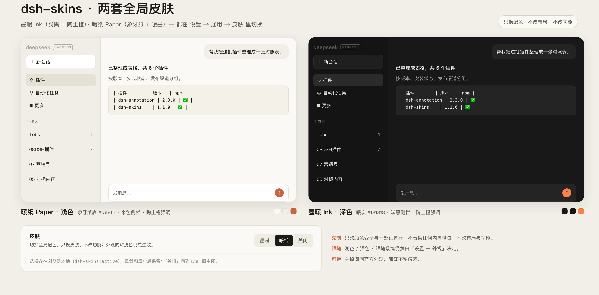
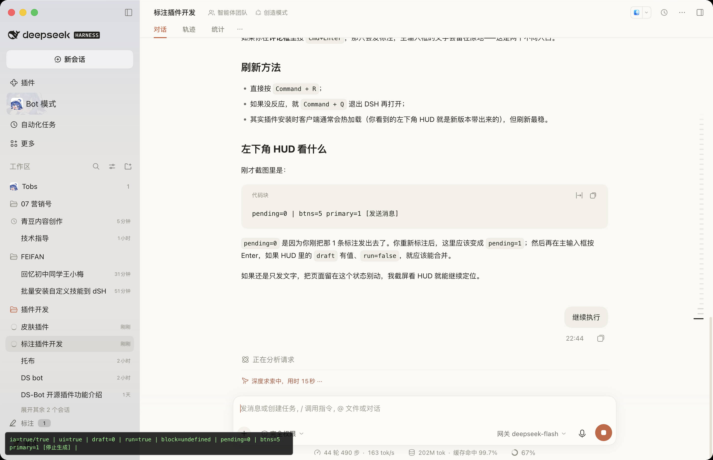
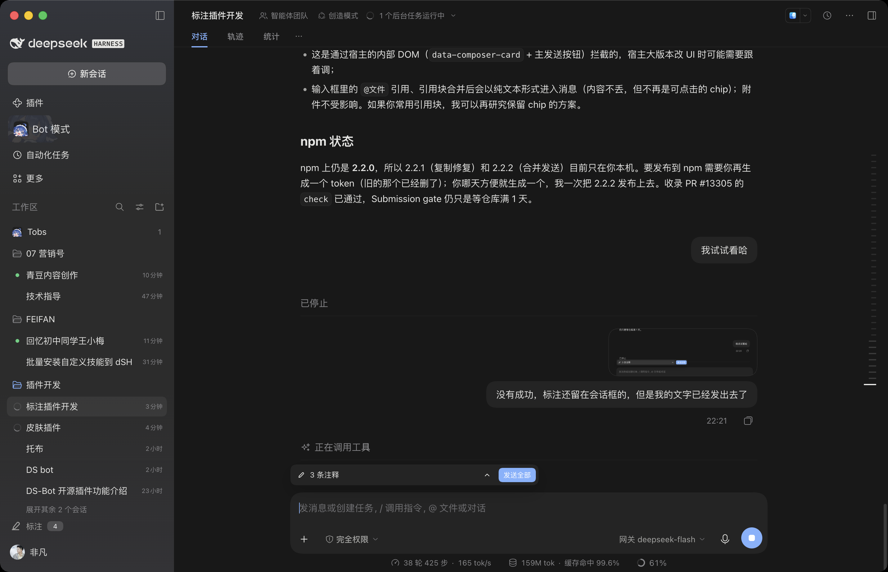

# Skins — global skin pack for DeepSeek Harness

[](https://www.npmjs.com/package/@fanfan4589/dsh-skins) [](./LICENSE)

A skin switcher **inside Settings**, not the sidebar: two global palettes for DeepSeek Harness, switched in one click, with no feature changes.

[中文](README.zh.md)

> **Scope — a small, restrained patch.** It does one thing and leaves the rest of DSH alone: no built-in slot or layout replaced, no core behaviour touched, no other plugin's data read or written. Upgrading DSH normally needs no change here; disabling or uninstalling restores the stock UI.



> Above: Paper (light) on the left, Ink (dark) on the right, and the **Settings → General → Skin** row underneath (Ink / Paper / Off). Colours only — layout, type scale and features are untouched.

| Paper (default, light) | Ink (dark) |
| --- | --- |
|  |  |

## Usage

**Settings → General → Skin** (between “Language” and “Appearance”):

| Choice | Result |
| --- | --- |
| Paper | Ivory `#faf9f5`, beige sidebar, warm ink `#1f1e1b`, terracotta `#c96442` |
| Ink | Charcoal `#181818`, warm neutral greys, terracotta accent |
| Off | Restores the shipped DSH theme |
| After switching | Applies instantly; survives reload and restart (`localStorage: dsh-skins:active`) |

Each skin ships both a light and a dark palette, so **Settings → Appearance** (light / dark / system) still applies. The skin only owns colour; it does not take over the appearance preference.

## How it works

- **Token-only**: each skin re-points ~106 `--dsw-*` design variables (palette ramps, semantic aliases, scenario tokens). No component replacement, no DOM reads, no feature changes.
- **Reading comfort**: body text keeps the highest contrast; tool rows, timestamps and telemetry step back through `secondary / tertiary / caption`; hairlines fade; content leading +1px.
- **Cold-start safe**: selectors sit one step above the base sheets (`html[data-dsh-skin="paper"] body…`), so the host’s later-injected base styles cannot override the skin.
- **One stylesheet**: switching only moves the `<html data-dsh-skin>` attribute — no style rebuild, no page reload.

## Install

Ask the DSH agent:

> install @fanfan4589/dsh-skins

or:

```bash
plugin_manager install_bundle @fanfan4589/dsh-skins
```

From a local checkout:

```bash
plugin_manager install_bundle /path/to/dsh-skins
```

## Compatibility

- Requires `dsh >= 0.2.1-rc.1` (web client).
- On macOS the sidebar is system vibrancy (the shipped CSS makes it transparent under `[data-platform=darwin]`), so its base colour is the OS material; tokens still control the sidebar’s inner elements and every non-darwin platform.
- Mutually exclusive with other skin plugins (all write `data-dsh-skin`) — keep one enabled at a time.

## Development

No build step: `client.js` is a browser-loadable module (`window.__ModuleLoader__.load`) with the CSS inlined.

```
dsh-skins/
├── client.js          # both palettes + the Settings row component + switching/persistence
├── index.js           # host half (empty; the bundle row must resolve)
├── cordis.patch.yml   # inserts the `skins` row
├── locale/{zh,en}.json
├── icon.svg
└── docs/              # screenshots
```

Editing `client.js` takes effect on the next page load (the plugin is link-installed).

## License

MIT © 2026 feifandiv
