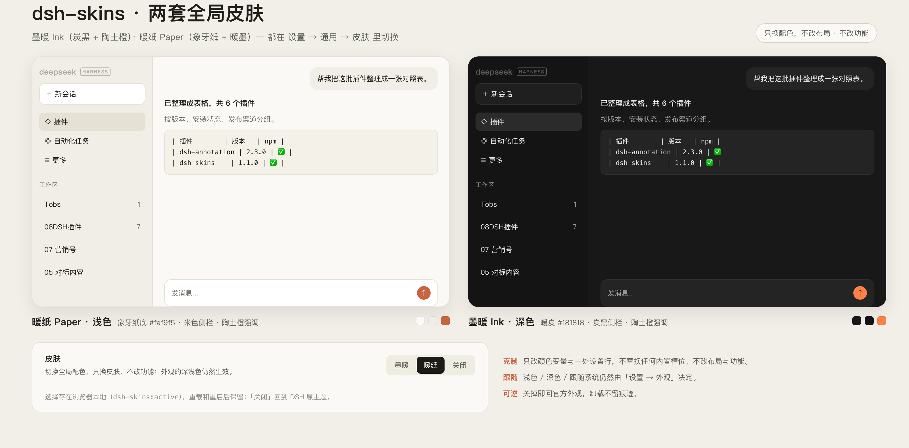
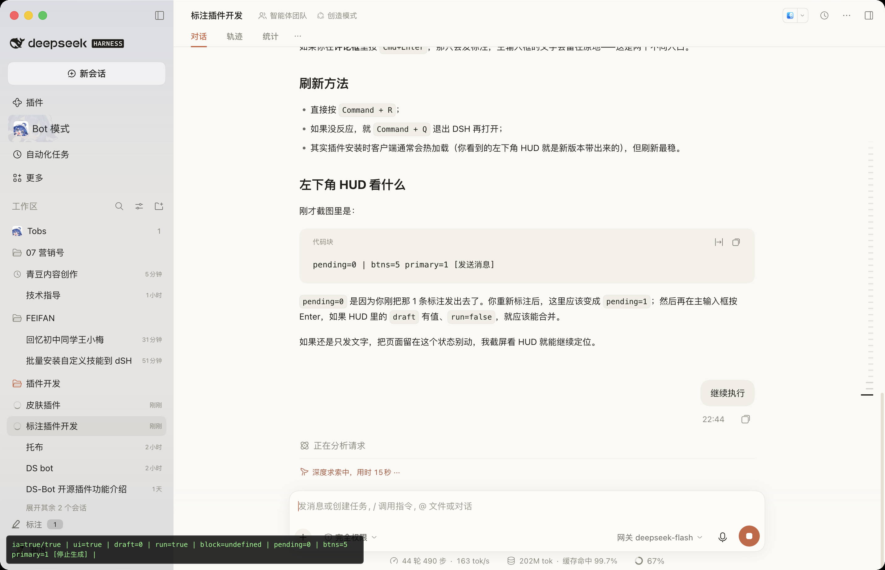
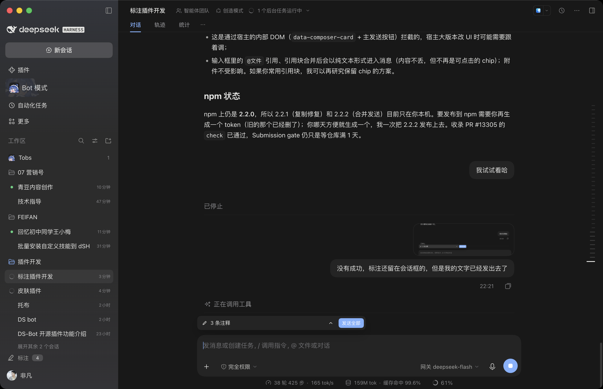

# 皮肤（Skins）— DSH 全局皮肤包

[](https://www.npmjs.com/package/@fanfan4589/dsh-skins) [](./LICENSE)

给 DeepSeek Harness 一个**设置里的皮肤切换器**：两套全局配色，一键切换，不占侧边栏、不改任何功能。

[English](README.md)

> **定位｜克制的小功能补丁。** 只做这一件事，不改 DSH 主体：不替换内置槽位与布局、不改内核行为、不碰其他插件的数据。升级 DSH 一般无需跟着改；关掉或卸载即回到官方状态。



> 上图：左「暖纸」浅色 · 右「墨暖」深色 · 底部是 **设置 → 通用 → 皮肤** 的切换行（墨暖 / 暖纸 / 关闭）。只换配色，布局、字号与功能都不变。

| 暖纸（默认，浅色） | 墨暖（深色） |
| --- | --- |
|  |  |

## 使用

入口在 **设置 → 通用 → 皮肤**（在「语言」下面、「外观」上面）：

| 操作 | 结果 |
| --- | --- |
| 选「暖纸」 | 象牙纸 `#faf9f5` + 米色侧栏 + 暖墨文字 `#1f1e1b` + 陶土橙 `#c96442` |
| 选「墨暖」 | 炭黑 `#181818` + 暖中性灰 + 陶土橙强调 |
| 选「关闭」 | 回到 DSH 原主题 |
| 切换后 | 立即生效，不重排、不闪烁；刷新和重启后保留（`localStorage: dsh-skins:active`） |

两套皮肤各自带**浅色 + 深色**两套配色，所以「设置 → 外观」的浅色 / 深色 / 跟随系统照常生效；皮肤只管色板，不接管外观偏好。

## 做了什么

- **只改设计 token**：每套皮肤重指约 106 个 `--dsw-*` 变量（色阶 / 语义别名 / 场景 token），不替换组件、不读 DOM、不改功能。
- **阅读降噪**：正文保留最高对比度，工具行 / 时间戳 / 统计等次级信息按 `secondary / tertiary / caption` 依次退后，1px 网格线淡化，正文行高 +1px。
- **冷启动安全**：选择器比基础样式高一档（`html[data-dsh-skin="paper"] body…`），宿主后注入的基础样式盖不掉皮肤。
- **两套皮肤同一张表**：切换只移动 `<html data-dsh-skin>` 一个属性，不重建样式、不重载页面。

## 安装

在 DSH 里让 Agent 安装（推荐）：

> 安装 @fanfan4589/dsh-skins

或直接：

```bash
plugin_manager install_bundle @fanfan4589/dsh-skins
```

本地开发时安装目录：

```bash
plugin_manager install_bundle /path/to/dsh-skins
```

## 兼容性

- 需要 `dsh >= 0.2.1-rc.1`（Web 客户端）。
- macOS 侧边栏是系统 vibrancy 材质（官方样式在 `[data-platform=darwin]` 下把它设为透明），
  所以侧栏底色由系统决定，token 只控制侧栏内部元素与非 darwin 平台。
- 与其它皮肤插件互斥（都写 `data-dsh-skin`），同一时间只启用一个皮肤包。

## 开发

无构建步骤：`client.js` 即浏览器可加载模块（`window.__ModuleLoader__.load`），CSS 内联其中。

```
dsh-skins/
├── client.js          # 两套皮肤 CSS + 设置行组件 + 切换/持久化
├── index.js           # Host 半边（空实现，bundle 行需可解析）
├── cordis.patch.yml   # 插入行 skins
├── locale/{zh,en}.json
├── icon.svg
└── docs/              # 截图
```

修改 `client.js` 后刷新页面即可生效（插件目录是 link 安装）。

## License

MIT © 2026 feifandiv
